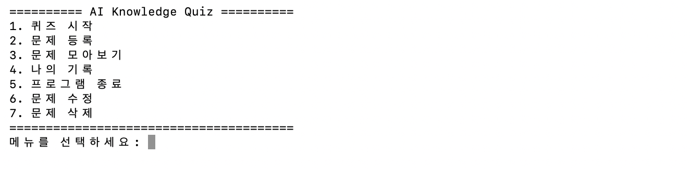
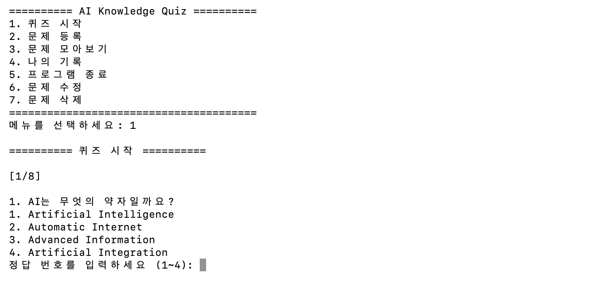
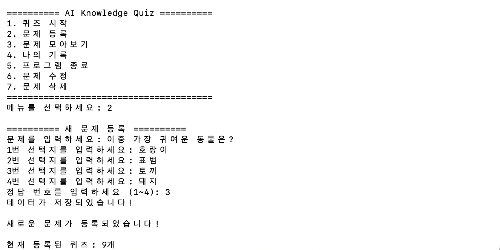
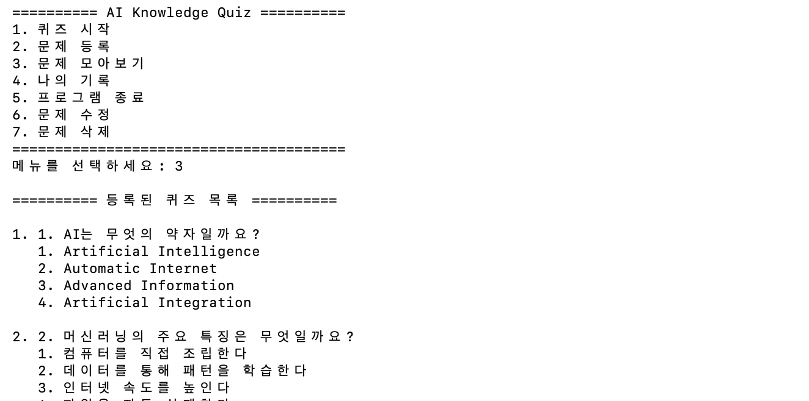
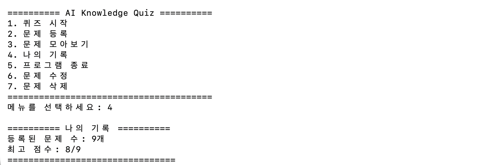
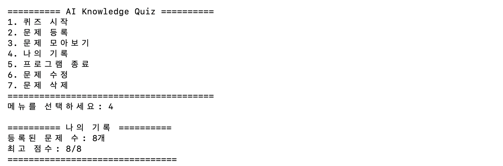
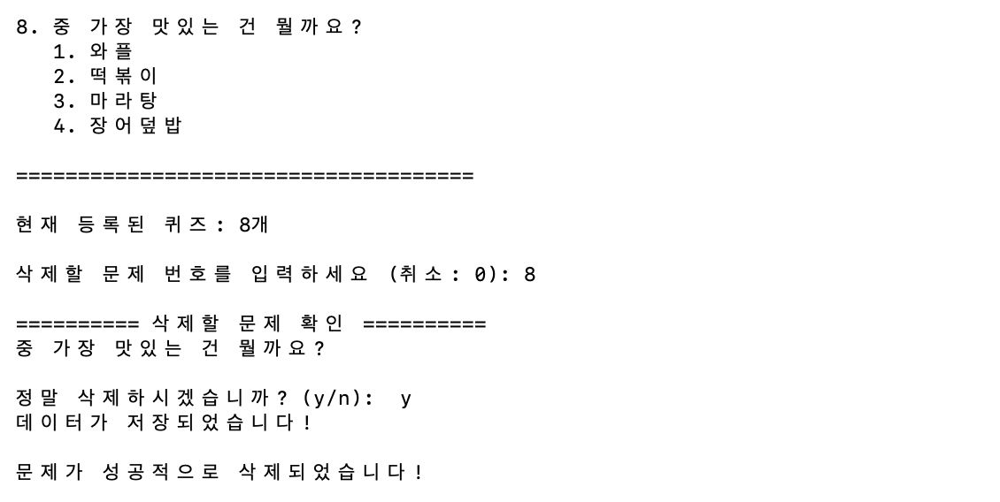
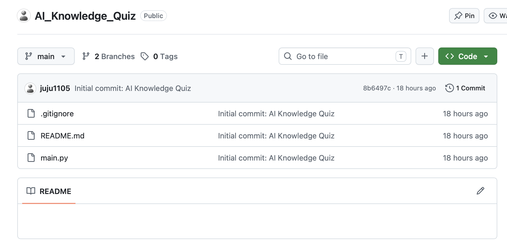

cat > README.md <<'EOF'
# 🧠 AI Knowledge Quiz

**인공지능 관련 지식을 재미있게 학습할 수 있는 Python 기반 퀴즈 프로그램입니다.**

사용자는 다양한 인공지능 관련 문제를 풀고, 새로운 문제를 직접 등록하거나 기존 문제를 수정 및 삭제할 수 있습니다. JSON 파일을 활용하여 퀴즈 데이터와 최고 점수를 저장하고 관리합니다.

---

## 📌 1. 프로젝트 소개

### 🎯 개발 목적

- Python 객체지향 프로그래밍(OOP) 학습
- 클래스와 메서드를 활용한 프로그램 설계
- 사용자 입력에 따른 기능 구현
- JSON을 활용한 데이터 저장 및 관리
- Git과 GitHub를 이용한 버전 관리

| 항목 | 내용 |
|---|---|
| 프로젝트명 | AI Knowledge Quiz |
| 개발 언어 | Python |
| 개발 환경 | macOS / Python 3.13 |
| 데이터 저장 | JSON |
| 프로그래밍 방식 | 객체지향 프로그래밍(OOP) |

---

## ⚙️ 2. 주요 기능

| 기능 | 설명 |
|---|---|
| 퀴즈 시작 | 등록된 문제를 풀고 점수 확인 |
| 문제 등록 | 새로운 질문과 선택지 및 정답 추가 |
| 문제 모아보기 | 등록된 전체 퀴즈 확인 |
| 나의 기록 | 등록된 문제 수와 최고 점수 확인 |
| 문제 수정 | 기존 질문, 선택지, 정답 변경 |
| 문제 삭제 | 불필요한 문제 삭제 |
| 데이터 저장 | JSON 파일을 이용한 데이터 유지 |

### 💾 데이터 관리

- `state.json` 파일에 퀴즈 데이터와 최고 점수 저장
- 프로그램 재실행 후에도 기존 데이터 유지
- 문제 등록, 수정, 삭제 시 변경 사항 저장
- 잘못된 입력과 데이터 형식에 대한 예외 처리

---

## 🛠️ 3. 사용 기술

| 기술 | 활용 내용 |
|---|---|
| Python | 프로그램 전체 구현 |
| Class / Object | Quiz 및 QuizGame 클래스 설계 |
| List / Dictionary | 퀴즈 데이터 관리 |
| JSON | 데이터 저장 및 불러오기 |
| Exception Handling | 입력 및 데이터 오류 처리 |
| Git | 소스 코드 버전 관리 |
| GitHub | 원격 저장소 및 프로젝트 관리 |

---

## 🚀 4. 실행 방법

### ① 저장소 복제

```bash
git clone https://github.com/사용자이름/AI_Knowledge_Quiz.git
```

### ② 프로젝트 폴더 이동

```bash
cd AI_Knowledge_Quiz
```

### ③ 프로그램 실행

```bash
python3 main.py
```

> Python 3.10 이상 환경을 권장합니다.

---

## 📂 5. 프로젝트 구조

```text
AI_Knowledge_Quiz/
│
├── main.py
├── state.json
├── README.md
├── .gitignore
│
└── screenshots/
    ├── 01-main-menu.png
    ├── 02-quiz-play.png
    ├── 03-quiz-add.png
    ├── 04-quiz-list.png
    ├── 05-quiz-edit.png
    ├── 05-quiz-edit2.png
    ├── 05-quiz-edit3.png
    ├── 06-quiz-record.png
    ├── 07-quiz-delete.png
    └── 08-github-repository.png
```

※ `state.json`은 로컬에서 프로그램을 실행할 때 생성 및 관리되는 데이터 파일이며, `.gitignore`에 의해 GitHub 업로드 대상에서 제외됩니다.

---

## 🖥️ 6. 실행 화면

### 01. 메인 메뉴

프로그램의 주요 기능을 선택할 수 있는 초기 화면입니다.



### 02. 퀴즈 실행

등록된 문제와 선택지를 확인하고 정답을 입력합니다.



### 03. 문제 등록

새로운 질문과 4개의 선택지 및 정답을 등록할 수 있습니다.



### 04. 문제 목록

현재 프로그램에 등록된 전체 퀴즈를 확인할 수 있습니다.



### 05. 문제 수정

기존에 등록된 질문과 선택지 및 정답을 수정할 수 있습니다.

**수정 화면 1**



**수정 화면 2**


**수정 화면 3**


### 06. 나의 기록

등록된 문제 수와 최고 점수를 확인할 수 있습니다.



### 07. 문제 삭제

선택한 문제를 삭제하고 변경된 데이터를 저장합니다.



---

## 🌐 7. Git / GitHub 활용

프로젝트의 버전 관리와 원격 저장소 관리를 위해 Git과 GitHub를 활용했습니다.

### 주요 실습 내용

- Git 로컬 저장소 생성 및 초기 설정
- `.gitignore`를 통한 관리 제외 파일 설정
- `git add`와 `git commit`을 이용한 버전 기록
- GitHub 원격 저장소 연결 및 `git push`
- 브랜치 생성 및 전환
- 브랜치 병합(Merge)
- 로컬 및 원격 브랜치 관리
- 커밋 기록과 프로젝트 상태 확인

### GitHub 저장소

프로젝트 소스 코드와 버전 관리 내역은 GitHub에서 확인할 수 있습니다.



---

## 📈 8. 프로젝트를 통해 배운 점

이번 프로젝트를 통해 Python의 클래스와 객체를 활용하여 프로그램 구조를 설계하고, 사용자 입력에 따라 여러 기능을 처리하는 방법을 학습했습니다.

또한 JSON 파일을 이용한 데이터 저장 및 불러오기, 예외 처리를 통한 오류 관리 방법을 경험했습니다.

Git과 GitHub를 활용하여 소스 코드의 변경 사항을 기록하고, 브랜치를 생성하고 병합하는 등 기본적인 버전 관리 과정도 익혔습니다.

**AI Knowledge Quiz는 Python 기초 문법부터 객체지향 프로그래밍, 데이터 관리, Git/GitHub 활용까지 경험하기 위해 제작한 프로젝트입니다.**
EOF

