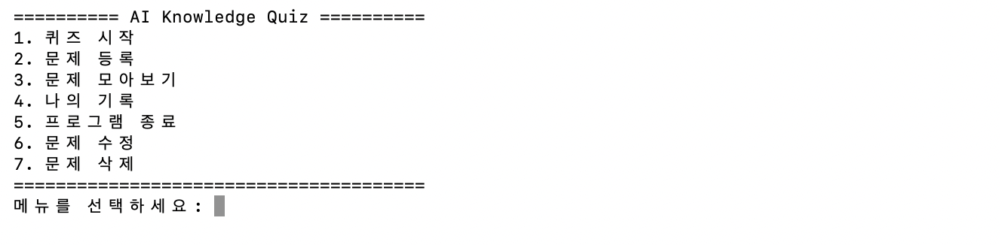
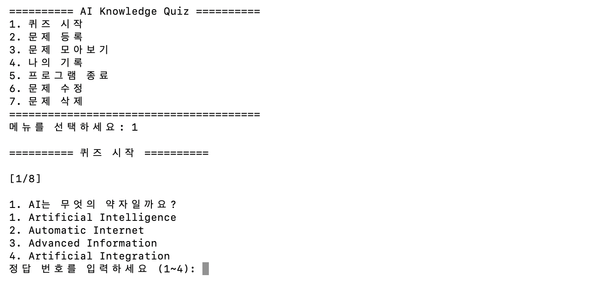
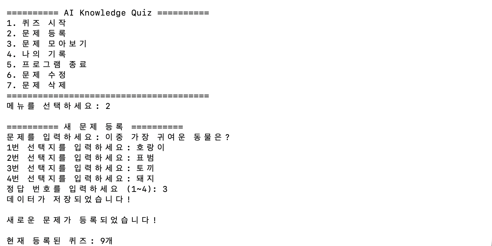
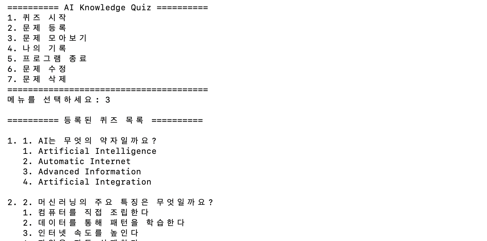
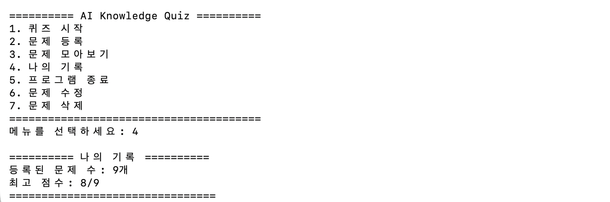
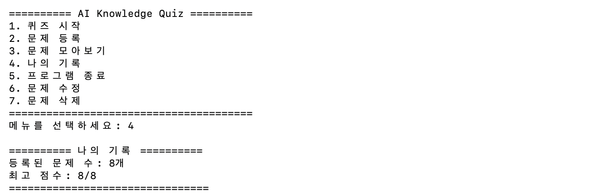
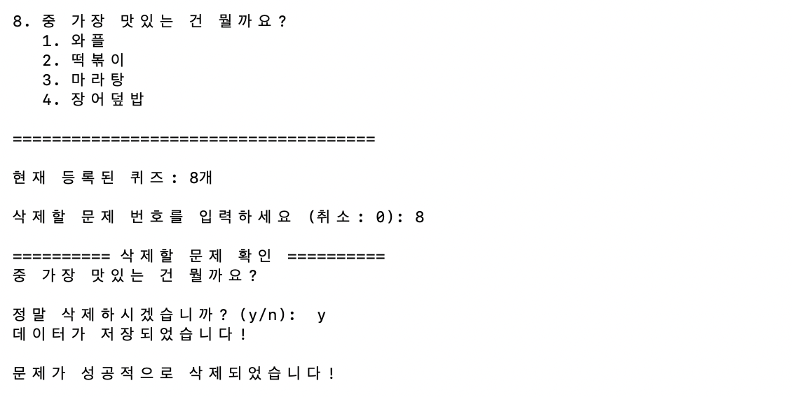
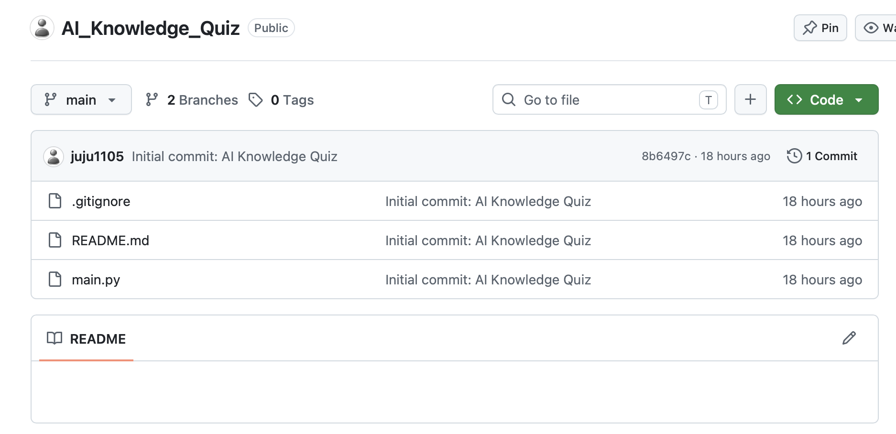

cat > README.md <<'EOF'
# 🧠 AI Knowledge Quiz

**인공지능 관련 지식을 재미있게 학습할 수 있는 Python 기반 퀴즈 프로그램입니다.**

사용자는 다양한 인공지능 관련 문제를 풀고, 새로운 문제를 직접 등록하거나 기존 문제를 수정 및 삭제할 수 있습니다. JSON 파일을 활용하여 퀴즈 데이터와 최고 점수를 저장하고 관리합니다.

---

## 📌 1. 프로젝트 소개

### 🎯 개발 목적

- Python 객체지향 프로그래밍(OOP) 학습
- 클래스와 메서드를 활용한 프로그램 설계
- 사용자 입력에 따른 기능 구현
- JSON을 활용한 데이터 저장 및 관리
- Git과 GitHub를 이용한 버전 관리

| 항목 | 내용 |
|---|---|
| 프로젝트명 | AI Knowledge Quiz |
| 개발 언어 | Python |
| 개발 환경 | macOS / Python 3.13 |
| 데이터 저장 | JSON |
| 프로그래밍 방식 | 객체지향 프로그래밍(OOP) |

---

## ⚙️ 2. 주요 기능

| 기능 | 설명 |
|---|---|
| 퀴즈 시작 | 등록된 문제를 풀고 점수 확인 |
| 문제 등록 | 새로운 질문과 선택지 및 정답 추가 |
| 문제 모아보기 | 등록된 전체 퀴즈 확인 |
| 나의 기록 | 등록된 문제 수와 최고 점수 확인 |
| 문제 수정 | 기존 질문, 선택지, 정답 변경 |
| 문제 삭제 | 불필요한 문제 삭제 |
| 데이터 저장 | JSON 파일을 이용한 데이터 유지 |

### 💾 데이터 관리

- `state.json` 파일에 퀴즈 데이터와 최고 점수 저장
- 프로그램 재실행 후에도 기존 데이터 유지
- 문제 등록, 수정, 삭제 시 변경 사항 저장
- 잘못된 입력과 데이터 형식에 대한 예외 처리

---

## 🛠️ 3. 사용 기술

| 기술 | 활용 내용 |
|---|---|
| Python | 프로그램 전체 구현 |
| Class / Object | Quiz 및 QuizGame 클래스 설계 |
| List / Dictionary | 퀴즈 데이터 관리 |
| JSON | 데이터 저장 및 불러오기 |
| Exception Handling | 입력 및 데이터 오류 처리 |
| Git | 소스 코드 버전 관리 |
| GitHub | 원격 저장소 및 프로젝트 관리 |

---

## 🏗️ 4. 객체지향 프로그래밍 설계

본 프로젝트는 객체지향 프로그래밍(OOP) 방식으로 설계했으며, `Quiz`와 `QuizGame` 두 개의 클래스를 중심으로 기능을 분리했습니다.

### ① Quiz 클래스

퀴즈 한 문제를 표현하는 클래스입니다. 질문, 선택지, 정답을 객체의 속성으로 관리하며 문제 출력과 정답 확인 기능을 담당합니다.

| 메서드 | 역할 |
|---|---|
| `__init__()` | 질문, 선택지, 정답 초기화 |
| `show_question()` | 질문과 선택지 출력 |
| `check_answer()` | 사용자 답안의 정답 여부 확인 |

### ② QuizGame 클래스

퀴즈 프로그램 전체의 흐름과 기능을 관리하는 클래스입니다. 문제 등록, 수정, 삭제부터 게임 진행, 점수 관리, 데이터 저장 및 불러오기까지 담당합니다.

| 메서드 | 역할 |
|---|---|
| `run()` | 메인 메뉴 및 프로그램 실행 |
| `play_quiz()` | 퀴즈 진행 및 점수 계산 |
| `add_quiz()` | 새로운 문제 등록 |
| `edit_quiz()` | 기존 문제 수정 |
| `delete_quiz()` | 기존 문제 삭제 |
| `show_quizzes()` | 전체 문제 목록 출력 |
| `show_record()` | 최고 점수 및 기록 확인 |
| `load_data()` | JSON 파일에서 데이터 불러오기 |
| `save_data()` | 데이터를 JSON 파일에 저장 |

### ③ 객체지향 프로그래밍을 적용한 이유

- **역할 분리:** 퀴즈 한 문제를 관리하는 기능과 전체 게임을 운영하는 기능을 구분했습니다.
- **코드 재사용:** Quiz 객체를 생성하여 여러 문제를 동일한 구조로 관리할 수 있습니다.
- **유지보수성:** 특정 기능을 수정할 때 관련 클래스와 메서드를 중심으로 변경할 수 있습니다.
- **확장성:** 새로운 퀴즈 관리 기능이나 게임 기능을 추가하기 쉽도록 구성했습니다.

---

## 🚀 4. 실행 방법

### ① 저장소 복제

```bash
git clone https://github.com/사용자이름/AI_Knowledge_Quiz.git
```

### ② 프로젝트 폴더 이동

```bash
cd AI_Knowledge_Quiz
```

### ③ 프로그램 실행

```bash
python3 main.py
```

> Python 3.10 이상 환경을 권장합니다.

---

## 📂 5. 프로젝트 구조

```text
AI_Knowledge_Quiz/
│
├── main.py
├── state.json
├── README.md
├── .gitignore
│
└── screenshots/
    ├── 01-main-menu.png
    ├── 02-quiz-play.png
    ├── 03-quiz-add.png
    ├── 04-quiz-list.png
    ├── 05-quiz-edit.png
    ├── 05-quiz-edit2.png
    ├── 05-quiz-edit3.png
    ├── 06-quiz-record.png
    ├── 07-quiz-delete.png
    └── 08-github-repository.png
```

※ `state.json`은 로컬에서 프로그램을 실행할 때 생성 및 관리되는 데이터 파일이며, `.gitignore`에 의해 GitHub 업로드 대상에서 제외됩니다.

---

## 🖥️ 6. 실행 화면

### 01. 메인 메뉴

프로그램의 주요 기능을 선택할 수 있는 초기 화면입니다.



### 02. 퀴즈 실행

등록된 문제와 선택지를 확인하고 정답을 입력합니다.



### 03. 문제 등록

새로운 질문과 4개의 선택지 및 정답을 등록할 수 있습니다.



### 04. 문제 목록

현재 프로그램에 등록된 전체 퀴즈를 확인할 수 있습니다.



### 05. 문제 수정

기존에 등록된 질문과 선택지 및 정답을 수정할 수 있습니다.

**수정 화면 1**



**수정 화면 2**


**수정 화면 3**


### 06. 나의 기록

등록된 문제 수와 최고 점수를 확인할 수 있습니다.



### 07. 문제 삭제

선택한 문제를 삭제하고 변경된 데이터를 저장합니다.



---

## 🌐 7. Git / GitHub 활용

프로젝트의 버전 관리와 원격 저장소 관리를 위해 Git과 GitHub를 활용했습니다.

### 주요 실습 내용

- Git 로컬 저장소 생성 및 초기 설정
- `.gitignore`를 통한 관리 제외 파일 설정
- `git add`와 `git commit`을 이용한 버전 기록
- GitHub 원격 저장소 연결 및 `git push`
- 브랜치 생성 및 전환
- 브랜치 병합(Merge)
- 로컬 및 원격 브랜치 관리
- 커밋 기록과 프로젝트 상태 확인

### GitHub 저장소

프로젝트 소스 코드와 버전 관리 내역은 GitHub에서 확인할 수 있습니다.



### Git 커밋 규칙

프로젝트의 변경 사항을 기능 단위로 구분하여 커밋했다.

**커밋 메시지 작성 규칙**

| 접두사 | 의미 |
|---|---|
| `feat:` | 새로운 기능 추가 |
| `fix:` | 오류 수정 |
| `docs:` | 문서 수정 |
| `refactor:` | 코드 구조 개선 |
| `merge:` | 브랜치 병합 |

**커밋 예시**
- `feat: add data backup and recovery`
- `docs: update project README`
- `fix: handle invalid user input`

작업 내용을 명확하게 구분하여 변경 이력을 쉽게 확인하고 관리할 수 있도록 했다.

### 브랜치 전략 및 병합

기능 개발 시 별도의 브랜치를 생성하여 작업하고, 작업이 완료되면 `main` 브랜치에 병합하는 방식을 사용했다.

**사용한 브랜치**
- `main`: 안정적인 최종 프로젝트 코드 관리
- `feature/data-backup`: 데이터 백업 및 복구 기능 개발

**Git 작업 흐름**

1. `git switch -c feature/data-backup` 명령어로 기능 브랜치를 생성한다.
2. 해당 브랜치에서 기능을 개발한다.
3. `git add`와 `git commit`으로 변경 사항을 기록한다.
4. `git push`로 GitHub에 브랜치를 업로드한다.
5. `git merge`를 사용하여 기능 브랜치를 `main`에 병

---

## 📈 8. 프로젝트를 통해 배운 점

이번 프로젝트를 통해 Python의 클래스와 객체를 활용하여 프로그램 구조를 설계하고, 사용자 입력에 따라 여러 기능을 처리하는 방법을 학습했습니다.

또한 JSON 파일을 이용한 데이터 저장 및 불러오기, 예외 처리를 통한 오류 관리 방법을 경험했습니다.

Git과 GitHub를 활용하여 소스 코드의 변경 사항을 기록하고, 브랜치를 생성하고 병합하는 등 기본적인 버전 관리 과정도 익혔습니다.

**AI Knowledge Quiz는 Python 기초 문법부터 객체지향 프로그래밍, 데이터 관리, Git/GitHub 활용까지 경험하기 위해 제작한 프로젝트입니다.**
EOF

## ⚠️ 예외 처리 및 프로그램 안정성

프로그램 실행 중 예상하지 못한 입력 상황이나 사용자에 의한 실행 중단에 대응하기 위해 예외 처리를 적용했다.

### ① KeyboardInterrupt

사용자가 터미널에서 `Ctrl + C`를 눌러 프로그램을 중단하면 발생하는 예외이다.

- 프로그램이 갑자기 종료되는 대신 안내 메시지를 출력한다.
- 사용자가 의도적으로 실행을 중단한 상황을 처리한다.

### ② EOFError

입력 데이터가 더 이상 전달되지 않을 때 발생하는 예외이다.

- 입력이 종료된 상황을 감지한다.
- 안내 메시지를 출력하고 프로그램을 안전하게 종료한다.

### ③ finally

`finally` 블록은 예외 발생 여부와 관계없이 마지막에 실행된다.

- 프로그램 종료 안내 메시지를 출력한다.
- 종료 과정을 일관되게 관리한다.

이러한 예외 처리를 통해 프로그램의 실행 안정성과 사용자 경험을 개선했다.

## 🔍 변경 영향 분석

새로운 기능을 추가하거나 기존 기능을 수정할 때는 관련된 클래스와 메서드의 역할을 파악하고 수정 범위를 결정해야 한다.

### ① 퀴즈 기능 변경

- `Quiz` 클래스: 문제 출력 및 정답 확인 방식 수정
- `QuizGame.play_quiz()`: 퀴즈 진행 순서와 점수 계산 방식 수정

### ② 데이터 구조 변경

- `QuizGame.load_data()`: JSON 파일에서 새로운 데이터 형식 읽기
- `QuizGame.save_data()`: 변경된 데이터 구조에 맞춰 저장
- `read_data_file()`: 데이터 유효성 검사 기준 수정

### ③ 문제 관리 기능 추가

- `QuizGame.add_quiz()`: 문제 등록 기능
- `QuizGame.edit_quiz()`: 문제 수정 기능
- `QuizGame.delete_quiz()`: 문제 삭제 기능

### ④ 데이터 백업 및 복구 기능 변경

- `QuizGame.save_data()`: 백업 파일 생성 및 저장 과정 수정
- `QuizGame.load_data()`: 데이터 오류 발생 시 복구 과정 수정
- `read_data_file()`: 백업 데이터의 유효성 검사

기능을 수정할 때는 직접 관련된 메서드뿐 아니라 데이터를 불러오고 저장하는 과정에도 영향이 있는지 확인해야 한다. 이를 통해 기존 기능의 오류를 예방하고 프로그램의 유지보수성을 높일 수 있다.

## 💾 JSON 데이터 저장 및 관리

본 프로젝트는 퀴즈 데이터와 최고 점수를 유지하기 위해 JSON(JavaScript Object Notation) 형식을 사용합니다.

### ① JSON 데이터 구조

프로그램의 데이터는 `state.json` 파일에 저장되며, 최상위 데이터는 `best_score`와 `quizzes`로 구성됩니다.

| 필드 | 자료형 | 역할 |
|---|---|---|
| `best_score` | Integer | 사용자의 최고 점수 저장 |
| `quizzes` | List | 전체 퀴즈 데이터 저장 |
| `question` | String | 문제 내용 저장 |
| `choices` | List | 문제의 선택지 저장 |
| `answer` | Integer | 정답 번호 저장 |

각 퀴즈는 질문, 선택지 목록, 정답 번호를 하나의 데이터로 관리합니다. 여러 퀴즈는 `quizzes` 배열에 저장됩니다.

### ② JSON을 선택한 이유

- **가독성:** 사람이 직접 파일을 열어 데이터 구조를 확인할 수 있습니다.
- **간편성:** Python의 기본 `json` 모듈을 이용해 데이터를 저장하고 불러올 수 있습니다.
- **구조화:** 리스트와 딕셔너리를 활용하여 여러 문제와 점수를 체계적으로 관리할 수 있습니다.
- **학습 목적:** 별도의 데이터베이스 서버 없이 파일 입출력과 데이터 직렬화 과정을 학습할 수 있습니다.

### ③ JSON의 한계와 개선 방향

JSON은 소규모 프로그램에서 사용하기 편리하지만 다음과 같은 한계가 있습니다.

- 데이터가 많아지면 파일 전체를 읽고 쓰는 작업에 시간이 걸릴 수 있습니다.
- 여러 사용자가 동시에 데이터를 수정하는 환경에는 적합하지 않습니다.
- 복잡한 조건 검색이나 데이터 간 관계 관리에는 한계가 있습니다.

향후 데이터 규모가 커지거나 여러 사용자가 데이터를 공유해야 한다면 SQLite 또는 MySQL과 같은 데이터베이스를 사용하는 방식으로 개선할 수 있습니다.

### 데이터 백업 및 복구 전략

프로그램은 기존 데이터가 저장된 `state.json` 파일을 새로운 데이터로 덮어쓰기 전에 백업 파일인 `state.json.bak`을 생성한다.

**백업 과정**
1. 기존 `state.json` 파일이 존재하는지 확인한다.
2. 기존 JSON 데이터가 정상적으로 읽히는지 검사한다.
3. 정상적인 데이터라면 `shutil.copy2()`를 사용해 `state.json.bak`으로 복사한다.
4. 새로운 데이터를 `state.json`에 저장한다.

**복구 과정**
1. `state.json` 파일을 읽을 때 오류가 발생하면 백업 파일을 확인한다.
2. `state.json.bak` 파일의 데이터가 정상적이라면 해당 데이터를 불러온다.
3. 복구한 데이터를 다시 `state.json`에 저장한다.
4. 백업 파일까지 손상된 경우 기본 퀴즈 데이터로 프로그램을 실행한다.

이를 통해 데이터가 손상되거나 저장 과정에서 문제가 발생하더라도 기존 데이터를 복구할 수 있도록 설계했다.

**관련 기술**
- `shutil.copy2()` : 파일을 복사하면서 메타데이터도 보존
- `json.load()` : JSON 파일 읽기
- `json.dump()` : JSON 데이터 저장
- `os.path` : 파일 경로 관리

## 🔄 Git Clone 및 Pull 실습

### ① Git Clone

GitHub 원격 저장소의 프로젝트를 로컬 컴퓨터에 복제하였다.

```bash
git clone https://github.com/juju1105/AI_Knowledge_Quiz.git

## 🧪 기능 테스트 및 검증

프로그램의 주요 기능이 정상적으로 동작하는지 직접 실행하여 확인하였다.

| 테스트 항목 | 확인 내용 |
|---|---|
| 퀴즈 실행 | 문제 출력 및 정답 판별 |
| 문제 등록 | 새로운 문제 추가 및 저장 |
| 문제 수정 | 기존 문제 내용 변경 |
| 문제 삭제 | 선택한 문제 삭제 |
| 데이터 저장 | JSON 파일에 데이터 저장 |
| 데이터 복구 | 백업 파일을 이용한 복구 |
| 예외 처리 | Ctrl+C 및 입력 종료 상황 처리 |

테스트 결과 주요 기능이 정상적으로 동작하는 것을 확인하였다.